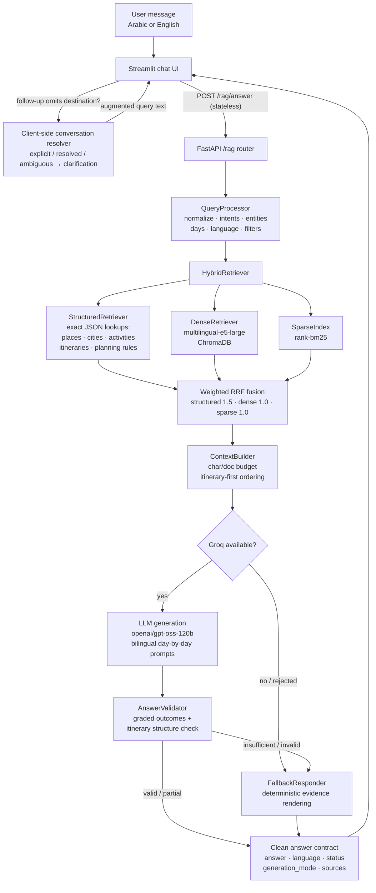

# RehlaAI — Egypt AI Tourism Guide 🇪🇬


**RehlaAI** ("رحلة" — *trip*) is a bilingual (Arabic/English) AI tourism assistant for Egypt. It answers questions about landmarks, ticket prices, opening hours, accessibility and transportation, and generates **day-by-day multi-day itineraries** — grounded entirely in a local, curated knowledge base, with **Groq-hosted LLM generation** on top and a **deterministic fallback** when the LLM is unavailable.

It is not a generic chatbot: every factual claim in an answer must be traceable to knowledge-base evidence, and answers that cannot be supported are honestly degraded instead of fabricated.

---

## Table of Contents

- [Project Overview](#project-overview)
- [Key Implemented Features](#key-implemented-features)
- [System Architecture](#system-architecture)
- [The RAG Pipeline in Detail](#the-rag-pipeline-in-detail)
- [Conversation Context & Itinerary Planning](#conversation-context--itinerary-planning)
- [Technology Stack](#technology-stack)
- [Project Structure](#project-structure)
- [Installation & Setup](#installation--setup)
- [Environment Variables](#environment-variables)
- [Running the Backend & the UI](#running-the-backend--the-ui)
- [API Documentation](#api-documentation)
- [Knowledge Base Overview](#knowledge-base-overview)
- [Testing & Evaluation](#testing--evaluation)
- [Current Limitations](#current-limitations)
- [Future Improvements](#future-improvements)
- [Contributing](#contributing)

---

## Project Overview

RehlaAI is a local-first hybrid RAG (Retrieval-Augmented Generation) system:

- **Retrieval is 100% local** — embeddings, a persistent vector store, a BM25 index, and exact structured lookups over a JSON knowledge base. Retrieval works with no internet and no LLM.
- **Generation uses Groq** (`openai/gpt-oss-120b` by default) and degrades gracefully to a **rule-based, evidence-driven fallback responder** on any provider failure — the user never sees a broken answer.
- **Every answer is validated** with graded outcomes; unsupported claims are rejected or qualified, never silently kept.
- **The user-facing contract is clean by design** — no internal IDs, no verification jargon, no "assembled from the knowledge base" notices, in both languages.

The project has been developed and hardened through iterative, evidence-based repair cycles (retrieval quality → clean-answer contract → itinerary day-by-day generation → conversation context & multi-destination planning), each locked in with regression suites.

## Key Implemented Features

| Feature | Status | Notes |
|---|---|---|
| Hybrid retrieval (dense + sparse + structured, RRF-fused) | ✅ Implemented | Weighted Reciprocal Rank Fusion |
| Bilingual query understanding (AR/EN) | ✅ Implemented | 11 intents, pattern-driven — no hardcoded examples |
| Trip-duration extraction | ✅ Implemented | Arabic-Indic & Western numerals, number words, colloquial forms |
| Multi-city destination detection | ✅ Implemented | All mentioned cities, deterministic mention order |
| Day-by-day itinerary generation (AR + EN) | ✅ Implemented | Exactly *N* day sections of ONE coherent plan |
| Multi-destination itinerary merging | ✅ Implemented | Deduplicated merge of existing KB plans; combined plans reused as-is |
| Conversation follow-up destination resolution | ✅ Implemented | Client-side; ambiguous context → clarification question |
| Groq generation with retries/backoff | ✅ Implemented | Model configurable via env, never hardcoded |
| Graded answer validation | ✅ Implemented | `valid` / `partially_supported` / `insufficient_evidence` / `invalid` |
| Deterministic fallback generation | ✅ Implemented | Renders KB evidence directly when Groq is unavailable |
| Clean user-facing answer contract | ✅ Implemented | No internal IDs or verification jargon leak |
| Streamlit chat UI with RTL/BiDi handling | ✅ Implemented | Per-block direction, tables, headings, transcript download |
| FastAPI service (`/rag/answer`, `/rag/retrieve`, `/rag/health`) | ✅ Implemented | Stateless request/response contract |
| Server-side conversation memory | ❌ Not implemented | Documented statelessness; context is owned by the client |
| Transportation routes data | ❌ Empty in KB | Queries get an honest "unavailable" answer, never invented routes |

## System Architecture



## The RAG Pipeline in Detail

### 1. Query processing (`rag/query_processing.py`)
- **Normalization** for Arabic (diacritics/tatweel stripping, hamza/alef variant collapsing) so `الأقصر` and `الاقصر` match identically.
- **Intent detection** — pattern-driven, bilingual: `price`, `hours`, `coordinates`, `accessibility`, `transportation`, `indoor_outdoor`, `age_suitability`, `activities`, `itinerary`, `recommendation`, `definition`. Structured intents route to exact fact lookups; an explicit trip length makes `itinerary` the primary intent.
- **Entity detection** — place names/aliases (normalized), Arabic city aliases, and **all mentioned cities in deterministic mention order** (`detected_cities`) for multi-destination queries.
- **Duration extraction** — `3 أيام`, `٣ أيام`, `لمدة يومين`, `three-day`, `a trip for two days`; budgets/counts/years are never misread as durations.
- **Language detection** per query (Arabic vs Latin character counts).

### 2. Hybrid retrieval (`rag/retrieval/`)
Three independent systems, fused with **weighted Reciprocal Rank Fusion** (`k = 60`):

| System | Mechanism | Weight |
|---|---|---|
| Structured | Exact JSON lookups (prices, hours, itineraries, cities, activities, planning rules) | **1.5** |
| Dense | `intfloat/multilingual-e5-large` embeddings via sentence-transformers, persisted in **ChromaDB** | 1.0 |
| Sparse | **rank-bm25** lexical index | 1.0 |

- Itinerary requests select **one best-matching KB plan** with a destination-purity-aware day-count distance (a combined "Luxor and Aswan" plan is not chosen over a pure Aswan plan when it must be truncated).
- Multi-destination requests retrieve evidence for **every** requested city.

### 3. Context building (`rag/context_builder.py`)
Assembles structured records and retrieved documents into one evidence block under a strict budget (`MAX_CONTEXT_CHARS=6000`, `MAX_CONTEXT_DOCS=8`). **Itinerary evidence is prioritized** so the plan itself is never the first thing trimmed by the char budget.

### 4. Generation (`rag/generation/`)
- **Groq path** — official Groq SDK, OpenAI-compatible chat completions; key read from `GROQ_API_KEY` (never hardcoded or logged); configurable model, temperature (`0.2`), timeout and retries with exponential backoff; explicit error classes (auth / rate-limit / network / empty). Language-specific system prompts mandate the exact `### Day 1 … ### Day N` structure in English and `### اليوم الأول …` in Arabic, and forbid unsupported numbers.
- **Validation** — `AnswerValidator` returns graded outcomes: every claim must be traceable to evidence; unsupported numbers are the only hard failure; partially supported answers are qualified, not discarded. Multi-day itineraries additionally get a **structural check** (exact day-section count, bilingual headings); flattened or leaking answers are replaced by the deterministic fallback.
- **Fallback path** — `FallbackResponder` renders the structured evidence directly: prices, hours, descriptions, itineraries with per-day stops and honest padding notes ("no further day details are available" — never invented attractions). The user cannot tell which mode produced the answer, and neither mode leaks internals.

### 5. Response contract (`rag/response.py`, `rag/api.py`)
The API returns a clean, user-facing payload — internal evidence structures stay in the `RAGResponse` object for the future agentic layer and are never serialized.

## Conversation Context & Itinerary Planning

### Conversation context (follow-ups)
The HTTP API is intentionally **stateless** — each `/rag/answer` request depends only on its own query (a documented, tested contract). Conversation continuity lives in the **client** (Streamlit), which owns the chat history:

1. When a follow-up is a plan request that omits the destination (`عاوز خطة 4 أيام` after `أفضل الأنشطة في أسوان`, or `Make it a 2-day plan` after `Things to do in Luxor`), the client resolves the destination from the **most recent destination-bearing user message** and appends it to the query text. Older, unrelated destinations never leak; assistant answers are never scanned.
2. An **explicit new destination overrides** the previous one (`خليها يومين في الأقصر`).
3. If the active context is genuinely **ambiguous** (several destinations), the UI asks a concise clarification question instead of guessing — no API call is made.
4. The original user text is always what is stored in the visible history.

### Itinerary planning
- Day-by-day plans in **both languages** with exactly the requested number of day sections (`### Day 1 — …` / `### اليوم الأول`).
- One coherent plan per answer — never a dump of several unrelated itineraries.
- When evidence covers fewer days than requested, extra days carry an **honest limitation note**; when a longer plan must be truncated, the answer says so. Nothing is fabricated.
- **Multi-destination** queries (`عاوز خطة 4 أيام في الجيزة والقاهرة` / `Create a 4-day itinerary covering Cairo and Giza.`) are answered by merging the best existing KB plan per destination, in mention order, with duplicate attractions and duplicate days removed and days renumbered — or by reusing a single KB plan that already covers both cities (`5 days from Luxor to Aswan`). Every stop comes verbatim from the knowledge base.

## Technology Stack

| Layer | Technology |
|---|---|
| Language | Python 3.11 |
| API | FastAPI + Pydantic v2, Uvicorn |
| UI | Streamlit (chat UI, BiDi/RTL CSS) |
| Embeddings | `sentence-transformers` with `intfloat/multilingual-e5-large` (Arabic + English) |
| Vector store | ChromaDB (local, persistent at `data/chroma/`) |
| Lexical retrieval | `rank-bm25` |
| Text splitting | `langchain-text-splitters` |
| LLM generation | Groq API (`openai/gpt-oss-120b` default, configurable) |
| Testing | pytest (396 tests, JUnit XML reports) |
| Config | Environment variables via `python-dotenv` (`.env`) |

Full dependency list: [`requirements-rag.txt`](requirements-rag.txt).

## Project Structure

```
Egypt-AI-Tourism-Guide/
├── rag/                        # The RAG pipeline package
│   ├── config.py               # All env-driven configuration (RAGConfig)
│   ├── pipeline.py             # RAGPipeline facade (retrieve / answer)
│   ├── server.py               # FastAPI app (uvicorn rag.server:app)
│   ├── api.py                  # /rag/retrieve, /rag/answer, /rag/health + schemas
│   ├── query_processing.py     # Bilingual intents, entities, durations, multi-city
│   ├── retrieval/
│   │   ├── dense.py            # e5 embeddings + ChromaDB
│   │   ├── sparse.py           # rank-bm25 index
│   │   ├── structured.py       # Exact JSON fact/itinerary lookups
│   │   ├── hybrid.py           # Weighted RRF fusion + itinerary selection
│   │   └── normalize.py        # Arabic normalization
│   ├── context_builder.py      # Budgeted evidence block (itinerary-first)
│   ├── generation/
│   │   ├── groq_client.py      # Groq SDK client, retries, typed errors
│   │   ├── prompts.py          # Bilingual system prompts (day-by-day mandates)
│   │   ├── validator.py        # Graded answer + itinerary structure validation
│   │   └── fallback.py         # Deterministic evidence responder
│   ├── response.py             # Clean user-facing answer assembly
│   ├── schemas.py              # RAGResponse / RetrievalResult / RetrievedContext
│   ├── embeddings.py · vector_store.py · cli.py
│   └── ingestion/              # loader · enhanced_loader · chunker · indexer
├── data/
│   ├── rehlaai_rag_data_enhanced.json   # The active knowledge base (source of truth)
│   └── egypt_landmarks_kb/              # Legacy per-landmark folder KB (backup)
├── tests/                      # 14 pytest suites (396 tests)
├── evaluation/                 # Retrieval/generation evaluation harness + datasets
├── docs/RAG.md                 # Deep-dive design notes
├── TestResults/                # Local JUnit XMLs + task reports (gitignored)
├── streamlit_app.py            # The chat UI (conversation context owner)
├── requirements-rag.txt
├── pytest.ini
└── .env.example
```

## Installation & Setup

Prerequisites: **Python 3.11** (tested on 3.11.9). A Groq API key is required only for LLM generation — retrieval and fallback answers work without it.

```bash
# 1. Clone
git clone https://github.com/Omar-Raghebb/Egypt-AI-Tourism-Guide.git
cd Egypt-AI-Tourism-Guide

# 2. Create a virtual environment
python -m venv .venv
.\.venv\Scripts\activate            # Windows
# source .venv/bin/activate         # Linux/macOS

# 3. Install dependencies
pip install -r requirements-rag.txt

# Optional GPU acceleration (NVIDIA CUDA 12.1):
# pip install torch --index-url https://download.pytorch.org/whl/cu121

# 4. Configure environment
copy .env.example .env              # Windows
# cp .env.example .env              # Linux/macOS
#   → set GROQ_API_KEY (get a free key at https://console.groq.com/keys)
```

The first pipeline start **builds the local indexes automatically** (embeddings → ChromaDB, BM25, structured lookups) and persists them under `data/chroma/`. A manual (re)build is also available:

```bash
python -m rag.cli build-index [--rebuild]
python -m rag.cli ask "What is the ticket price of the Pyramids?" --lang en
```

## Environment Variables

All pipeline configuration is read from the environment (a project-root `.env` is loaded automatically). See [`.env.example`](.env.example) for the complete list.

| Variable | Default | Purpose |
|---|---|---|
| `GROQ_API_KEY` | — | Groq API key (**required only for LLM generation**) |
| `GROQ_MODEL` | `openai/gpt-oss-120b` | Generation model |
| `GROQ_TEMPERATURE` / `GROQ_TOP_P` | `0.2` / `0.9` | Sampling |
| `GROQ_MAX_OUTPUT_TOKENS` | `1024` | Max generated tokens |
| `GROQ_TIMEOUT_SECONDS` / `GROQ_MAX_RETRIES` | `30` / `2` | Network resilience |
| `GROQ_API_KEY_ENV` | `GROQ_API_KEY` | Name of the env var holding the key |
| `KB_SINGLE_FILE` | `data/rehlaai_rag_data_enhanced.json` | Active (enhanced) knowledge base |
| `KB_PATH` | `data/egypt_landmarks_kb` | Legacy per-landmark folder KB |
| `EMBEDDING_MODEL` | `intfloat/multilingual-e5-large` | Embedding model |
| `EMBEDDING_DEVICE` | `auto` | `auto` / `cpu` / `cuda` |
| `CHROMA_PERSIST_DIRECTORY` | `data/chroma` | Vector store location |
| `CHROMA_COLLECTION_NAME` | `rehlai_knowledge` | Collection name |
| `CHUNK_SIZE` / `CHUNK_OVERLAP` | `300` / `45` | Text splitting |
| `TOP_K` / `DENSE_TOP_K` / `SPARSE_TOP_K` | `4` / `8` / `8` | Retrieval depth |
| `RRF_K` | `60` | RRF constant |
| `DENSE_WEIGHT` / `SPARSE_WEIGHT` / `STRUCTURED_WEIGHT` | `1.0` / `1.0` / `1.5` | Fusion weights |
| `MIN_RELEVANCE_THRESHOLD` | `0.0` | Dense ranking guardrail |
| `MAX_CONTEXT_CHARS` / `MAX_CONTEXT_DOCS` | `6000` / `8` | Context budget |

Streamlit client variables:

| Variable | Default | Purpose |
|---|---|---|
| `RAG_API_URL` | `http://127.0.0.1:8000` | Backend location |
| `RAG_API_TIMEOUT` | `120` | Request timeout (seconds) |
| `RAG_UI_DEBUG` | `0` (`1` to enable) | Show technical service status in the sidebar |

> Never commit `.env`. It is already covered by `.gitignore`.

## Running the Backend & the UI

**Backend (FastAPI):**

```bash
uvicorn rag.server:app --reload          # default: http://127.0.0.1:8000
```

**Chat UI (Streamlit) — in a second terminal:**

```bash
streamlit run streamlit_app.py
```

The UI provides: a bilingual chat with per-block RTL/LTR rendering, a language selector (Auto / English / العربية), suggested questions, destination shortcuts, an animated answer reveal, a conversation transcript download (`# RehlaAI — my Egypt trip notes`), and a new-chat reset. Health and component status are shown in the sidebar when `RAG_UI_DEBUG=1`.

## API Documentation

Interactive docs are served by FastAPI at `/docs`. The three endpoints:

| Method | Path | Purpose |
|---|---|---|
| `GET` | `/rag/health` | Component status (KB, indexes, embedding model, LLM provider) |
| `POST` | `/rag/retrieve` | Retrieval only — no LLM call (for the future agentic layer) |
| `POST` | `/rag/answer` | End-to-end RAG answer (retrieval + generation + validation) |

### `POST /rag/answer`

```json
{
  "query": "Plan a 3-day family trip to Cairo",
  "language": "en",
  "filters": null,
  "top_k": null
}
```

- `query` — required, 1–1000 chars.
- `language` — optional, `"en"` or `"ar"` (auto-detected when omitted).
- `filters` — optional (e.g. `{"city": "Cairo", "family_friendly": true}`).
- `top_k` — optional, 1–20.

**Response (verified contract):**

```json
{
  "response_id": "…",
  "query": "Plan a 3-day family trip to Cairo",
  "answer": "…\n\n### Day 1 — Giza\n…",
  "language": "en",
  "status": "success",
  "generation_mode": "groq",
  "sources": ["…"],
  "verification": { "…": "…" },
  "warnings": []
}
```

- `status` — `success` | `partial` | `unavailable` | `error`
- `generation_mode` — `groq` | `fallback`
- Multi-day itineraries contain exactly the requested number of `### Day N` / `### اليوم الأول … اليوم N` sections.

**Verified examples** (from the regression suites, executed against the router with TestClient):

```bash
curl -X POST http://127.0.0.1:8000/rag/answer \
  -H "Content-Type: application/json" \
  -d '{"query": "Plan a 3-day family trip to Cairo", "language": "en"}'

curl -X POST http://127.0.0.1:8000/rag/answer \
  -H "Content-Type: application/json" \
  -d '{"query": "اعملي برنامج سياحي في الأقصر لمدة يومين.", "language": "ar"}'

curl -X POST http://127.0.0.1:8000/rag/answer \
  -H "Content-Type: application/json" \
  -d '{"query": "عاوز خطة 4 أيام في الجيزة والقاهرة", "language": "ar"}'

curl -X POST http://127.0.0.1:8000/rag/retrieve \
  -H "Content-Type: application/json" \
  -d '{"query": "What is the ticket price of the Giza Pyramids?"}'
```

`/rag/retrieve` returns the fused documents, structured records/extras, detected
entities (`intent`, `days`, `city`, `cities`, …), methods used, warnings and latency —
the introspectable layer an agentic planner can build on.

## Knowledge Base Overview

The active knowledge base (`data/rehlaai_rag_data_enhanced.json`, loaded by `rag/ingestion/enhanced_loader.py`) is a single bilingual JSON file with per-field **data-quality/verification metadata**:

| Collection | Records | Content |
|---|---|---|
| `places` | 28 | Landmarks with descriptions, prices, hours, coordinates, accessibility, transportation, indoor/outdoor and age-suitability data |
| `cities` | 9 | Cairo, Giza, Luxor, Aswan, Alexandria, Sharm El-Sheikh, … (bilingual names + descriptions) |
| `activities` | 9 | Nile cruises, felucca rides, museum visits, guided tours, sound & light shows, … |
| `itineraries` | 6 | Ready-made day-by-day plans (Cairo, Giza, Luxor, Aswan, Alexandria, Luxor→Aswan) |
| `planning_rules_examples` | 3 | Practical visiting rules rendered as "Important notes" |
| `transportation_routes` | 0 | Schema defined, data empty — queries answer honestly "unavailable" |

Design rules enforced by the loader and responders:

- The enhanced KB is the **source of truth**; the legacy per-landmark folder KB (`data/egypt_landmarks_kb/`, with `faq.json` + images per landmark) is kept as a backup.
- Values marked **unverified / estimated / conflicting** in `data_quality` are never presented as confirmed facts — the user sees a brief natural "currently unavailable" line instead. Honesty by replacement, not by annotation.
- Itinerary stops reference place IDs and are resolved to human-readable bilingual names; nothing is rendered from internal IDs.

## Testing & Evaluation

### Regression suites (14 suites + shared fixtures, 396 tests — all passing)

| Suite | Focus |
|---|---|
| `test_user_contract.py` | The user-facing contract: clean answers, exact day counts, no fabricated costs, UI forbidden-string checks, documented API statelessness |
| `test_itinerary_structure.py` | Duration extraction, intent priority, itinerary selection, AR/EN day-by-day structure, Groq-mode structure preservation, validator, prompts, API contract, Streamlit rendering |
| `test_conversation_context.py` | Follow-up destination resolution (AR/EN, override, no-leak, ambiguity, assistant-scan guard), pure-city plans, multi-destination detection/merge/dedup, Streamlit augmented-query capture |
| `test_hybrid_and_context.py` · `test_retrieval_components.py` | City/place detection, RRF fusion, retriever components |
| `test_groq.py` · `test_groq_contract.py` | Groq client behavior: retries, typed errors, injected/mocked clients |
| `test_output_contract.py` · `test_output_refinement.py` | Bilingual output equivalence, clean-answer refinements |
| `test_loader.py` · `test_enhanced_kb.py` · `test_chunker.py` · `test_language_detection.py` · `test_pipeline_and_api.py` | Ingestion, KB loading/validation, chunking, language detection, pipeline & API |
| `conftest.py` | Shared fixtures (isolated KB subsets, test clients) |

Latest full run: **396 tests, 0 failures, 0 errors, 0 skipped** (256.9 s). JUnit XML reports and per-task investigation reports are written to `TestResults/` (a local, gitignored directory).

### Live LLM verification

During the itinerary-generation repair cycle, the Groq path was verified against the **live Groq API** with a bilingual AR/EN matrix (day-structure, language correctness, no internal leakage, mode checks) — results recorded locally in `TestResults/live_matrix_results.json` and summarized in `TestResults/itinerary_report.md`. Automated CI tests use injected/mocked Groq clients and are reported as such.

### Retrieval evaluation (`evaluation/`)

26-case bilingual evaluation on the enhanced KB (`evaluation/results_retrieval_enhanced.json`):

| Metric | Result |
|---|---|
| Precision@4 | **1.000** |
| Recall@4 | **1.000** |
| Hit rate@4 | **1.000** |
| MRR | **0.891** |
| Intent accuracy | **1.000** |
| Average latency | ≈ 544 ms |

## Current Limitations

- **Stateless API** — the server keeps no conversation memory; follow-up context is resolved client-side in the Streamlit app. Direct API consumers must resolve context themselves.
- **Knowledge-base scale** — 28 places across 9 cities. Coverage outside these destinations (and deeper per-place detail) is limited by the KB, and the system says so rather than inventing content.
- **Verification debt in the KB** — many KB fields are marked unverified in their own `data_quality` metadata, so those facts are intentionally presented as "currently unavailable" even though the pipeline works.
- **Transportation routes are empty** in the KB (schema exists); related queries get an honest unavailability answer.
- **Planning rules are English-only** in the KB; Arabic answers omit them instead of machine-translating.
- **No answer streaming** — the UI animates the reveal locally; the API is request/response.
- **Groq free-tier rate limits** apply to LLM generation; heavy usage can push answers to the deterministic fallback (which is always available).

## Future Improvements

- **Agentic planning layer** — the retrieval surface (`/rag/retrieve`, detected entities, structured extras) and the `RAGResponse` internals are already shaped for an agentic planner that would own server-side conversation memory and multi-step trip planning.
- **Populate transportation routes** and extend the KB's verified coverage (more places, verified prices/hours, Arabic planning rules).
- **Answer streaming** (SSE/WebSocket) for a more responsive UI.
- **CI** — the pytest suites are designed to run headless (mocked LLM); wiring them into GitHub Actions is straightforward but not yet set up.

## Contributing

1. Fork the repository and create a feature branch (`git checkout -b feature/my-feature`).
2. Run the test suite before and after your change: `python -m pytest tests` — all 396 tests must pass, and the pinned user-contract/itinerary suites must not be weakened.
3. Keep fixes targeted: reproduce first, change the responsible logic only, add a focused regression test.
4. Never commit `.env`, keys, or generated indexes (`data/chroma/`).
5. Open a pull request with a clear description of the change and the evidence (test output) behind it.

---

*Badges reflect the state verified in the November 2026 test runs. No license has been specified for this repository yet.*
